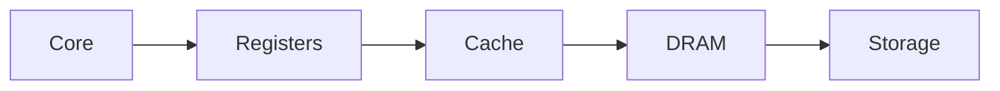

# Machine Fundamentals

**Prerequisites:** Basic shell commands and arrays; complete the setup page. No GPU is required.

**Objective:** Identify the resources a process can actually use and relate memory access patterns to cache behavior.

A core executes instructions; memory stores the data those instructions use. A cache is a small, fast store of recently used cache lines, usually containing several adjacent values. Performance depends on how often data can be reused before it leaves a cache. Inventory the resources assigned to your process before choosing thread counts or allocation sizes.

## Before You Run

Run commands from the repository root after [setup](../learning/setup.md). Use `source scripts/activate-study.sh` once per shell. These are 10, 20 and 30 minute exercises including interpretation, not promised program runtimes. Use `timeout 180s COMMAND` for individual local runs; allow up to 600 seconds for the native benchmark build. Keep allocations bounded and avoid other workloads during timing.

## Inventory Resources {#inventory}

**warm-up · 10 minutes · CPU; Linux; below 256 MiB**

Record the CPU model, allowed CPU set, and memory limit. Distinguish host totals from cgroup limits. Choose at most four threads for the first experiments.

```bash
lscpu
free -h
python -c "import os; print('allowed_cpus', len(os.sched_getaffinity(0)))"
python -c "from pathlib import Path; p=Path('/sys/fs/cgroup/memory.max'); print('cgroup_memory_limit', p.read_text().strip() if p.exists() else 'inspect your cgroup version')"
```

**Source:** [examples/cpu/memory.c](/hpc_study.io/downloads/source/examples/cpu/memory.c). Read the bounded inputs and independent checks in the source before editing a working copy.

**Expected behavior and correctness:** The allowed CPU set describes placement, while a cgroup CPU quota may allow fewer CPU equivalents. Inspect /sys/fs/cgroup/cpu.max as well. Use the smaller allocation limit, not the host memory total. GPU memory is a separate pool.

**Troubleshooting:** Host memory and allowed CPU count can exceed your job's quota. Missing cgroup v2 files mean you must inspect the system's cgroup layout; do not infer unlimited resources.

**Cleanup:** Programs release memory on exit. Keep your measurements; make clean is unnecessary. Generated executables are confined to build/.

??? success "Answer"

    The allowed CPU set describes placement, while a cgroup CPU quota may allow fewer CPU equivalents. Inspect /sys/fs/cgroup/cpu.max as well. Use the smaller allocation limit, not the host memory total. GPU memory is a separate pool.

## Measure Memory Access Patterns {#memory-patterns}

**core · 20 minutes · CPU; 128 MiB array**

Read the nested loops, predict the visited element counts for strides 1, 8 and 64, then run the program three times. Record time per visited element and useful bandwidth, not just total elapsed time.

```bash
make -C examples cpu
./build/memory
```

**Source:** [examples/cpu/memory.c](/hpc_study.io/downloads/source/examples/cpu/memory.c). Read the bounded inputs and independent checks in the source before editing a working copy.

**Expected behavior and correctness:** The program sums known 1.0 values and checks the result against 8 times the number of visits. Each larger stride performs fewer visits, so a shorter total time alone does not establish higher efficiency. Report the spread of repeated runs.

**Troubleshooting:** An allocation failure means the available limit is smaller than expected. Close other workloads or reduce n in a separate copy and disclose the changed size.

**Cleanup:** Programs release memory on exit. Keep your measurements; make clean is unnecessary. Generated executables are confined to build/.

??? success "Answer"

    The program sums known 1.0 values and checks the result against 8 times the number of visits. Each larger stride performs fewer visits, so a shorter total time alone does not establish higher efficiency. Report the spread of repeated runs.

## Explain Cache and Stride Effects {#cache-stride}

**stretch · 30 minutes · CPU; 128 MiB array**

Explain why stride 8 can fetch a cache line but use only one double. Compute useful bytes as visits times 8. Compare with the stride-1 result and state what this experiment cannot establish.

```bash
./build/memory
```

**Source:** [examples/cpu/memory.c](/hpc_study.io/downloads/source/examples/cpu/memory.c). Read the bounded inputs and independent checks in the source before editing a working copy.

**Expected behavior and correctness:** For a 64-byte cache line and 8-byte doubles, stride 8 touches one value per line; stride 64 skips more lines. Prefetching, TLB behavior, reuse and clock variation affect the measured result. Useful GB/s is not measured DRAM traffic; hardware counters would be needed for that claim.

**Troubleshooting:** Unexpected ordering is possible. Confirm PASS and counts first, retain all runs, and avoid claiming a particular cache-line size from timing alone.

**Cleanup:** Programs release memory on exit. Keep your measurements; make clean is unnecessary. Generated executables are confined to build/.

??? success "Answer"

    For a 64-byte cache line and 8-byte doubles, stride 8 touches one value per line; stride 64 skips more lines. Prefetching, TLB behavior, reuse and clock variation affect the measured result. Useful GB/s is not measured DRAM traffic; hardware counters would be needed for that claim.

## Memory Path



Cache hits can avoid slower transfers. The arrows describe movement, not equal bandwidth or latency.

## Next Steps

Continue to [the next module](../parallel-programming/parallel-programming-intro.md). Review [experiment status](../learning/validation.md) before reusing a performance claim.

