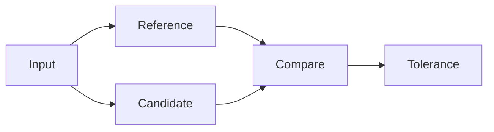

# Scientific Computing and ML

**Prerequisites:** Arrays, matrix multiplication and measurement; NumPy/SciPy and the CPU or GPU PyTorch extra.

**Objective:** Bound quantization error, verify a sparse solution and compare training precision.

A numerical result needs a tolerance and a reference. A residual measures how well a computed solution satisfies its equation. Training repeatedly evaluates a model, differentiates a loss and updates parameters. Faster arithmetic only helps when the resulting numerical error is acceptable for the application.

## Before You Run

Run commands from the repository root after [setup](../learning/setup.md). Use `source scripts/activate-study.sh` once per shell. These are 10, 20 and 30 minute exercises including interpretation, not promised program runtimes. Use `timeout 180s COMMAND` for individual local runs; allow up to 600 seconds for the native benchmark build. Keep allocations bounded and avoid other workloads during timing.

## Measure Quantization Error {#quantization-error}

**warm-up · 10 minutes · CPU; NumPy; below 64 MiB**

Predict the maximum rounding error for symmetric INT8 quantization. Run the example and compare restored floating-point weights with the originals. Calculate the storage ratio, including a scalar scale.

```bash
python examples/ml/quantize.py
```

**Source:** [examples/ml/quantize.py](/hpc_study.io/downloads/source/examples/ml/quantize.py). Read the bounded inputs and independent checks in the source before editing a working copy.

**Expected behavior and correctness:** With scale=max(abs(w))/127, rounding produces error at most scale/2 for these bounded inputs, up to floating-point roundoff. INT8 weight storage is one quarter of FP32 before scale metadata. This is a numerical demonstration, not an accelerated INT8 kernel.

**Troubleshooting:** The bound assumes the scale is nonzero and values remain in the calibrated range. New outliers may clip; all-zero tensors need explicit scale handling in a general implementation.

**Cleanup:** Programs release memory on exit. Keep your measurements; make clean is unnecessary. Generated executables are confined to build/.

??? success "Answer"

    With scale=max(abs(w))/127, rounding produces error at most scale/2 for these bounded inputs, up to floating-point roundoff. INT8 weight storage is one quarter of FP32 before scale metadata. This is a numerical demonstration, not an accelerated INT8 kernel.

## Verify Sparse Solving and Residuals {#sparse-residual}

**core · 20 minutes · CPU; SciPy; below 64 MiB**

Inspect the tridiagonal symmetric positive definite matrix. Explain why conjugate gradients is applicable, then compare its answer with a dense solve and the manufactured sine-vector solution.

```bash
python examples/science/solve.py
```

**Source:** [examples/science/solve.py](/hpc_study.io/downloads/source/examples/science/solve.py). Read the bounded inputs and independent checks in the source before editing a working copy.

**Expected behavior and correctness:** The script checks solver status, relative residual ||Ax-b||/||b|| and agreement with an independent dense solver. A small residual alone does not bound forward error without considering conditioning. The manufactured solution supplies another independent reference.

**Troubleshooting:** Failure to converge may reflect an unsuitable matrix, tolerance or iteration budget. Do not accept info>0 as success or silently replace NaN residuals.

**Cleanup:** Programs release memory on exit. Keep your measurements; make clean is unnecessary. Generated executables are confined to build/.

??? success "Answer"

    The script checks solver status, relative residual ||Ax-b||/||b|| and agreement with an independent dense solver. A small residual alone does not bound forward error without considering conditioning. The manufactured solution supplies another independent reference.

## Compare CPU/GPU Training and Precision {#training-precision}

**stretch · 30 minutes · CPU fallback or one CUDA GPU; below 1 GiB**

Verify loss decreases and the initial forward pass matches a CPU reference. Compare synchronized FP32/FP16 matrix timing and error against FP64. Record the CPU fallback separately if no GPU is visible.

```bash
python examples/ml/train.py --device cpu
python examples/ml/train.py --device cuda
python examples/ml/precision.py
```

**Source:** [examples/ml/train.py](/hpc_study.io/downloads/source/examples/ml/train.py), [examples/ml/precision.py](/hpc_study.io/downloads/source/examples/ml/precision.py). Read the bounded inputs and independent checks in the source before editing a working copy.

**Expected behavior and correctness:** The tiny regression is a correctness workload and may be slower on GPU because launch overhead dominates. FP16 permits more rounding error, checked against a declared tolerance. Disabling TF32 makes the FP32 comparison reproducible for this teaching case; it is not a universal production recommendation.

**Troubleshooting:** CUDA commands require the gpu extra. precision.py explicitly prints SKIP for CUDA without a device. CPU-only validation does not establish GPU speed or FP16 behavior.

**Cleanup:** Programs release memory on exit. Keep your measurements; make clean is unnecessary. Generated executables are confined to build/.

??? success "Answer"

    The tiny regression is a correctness workload and may be slower on GPU because launch overhead dominates. FP16 permits more rounding error, checked against a declared tolerance. Disabling TF32 makes the FP32 comparison reproducible for this teaching case; it is not a universal production recommendation.

## Validation Path



## Next Steps

Continue to [the next module](../clusters/platform-intro.md). Review [experiment status](../learning/validation.md) before reusing a performance claim.

